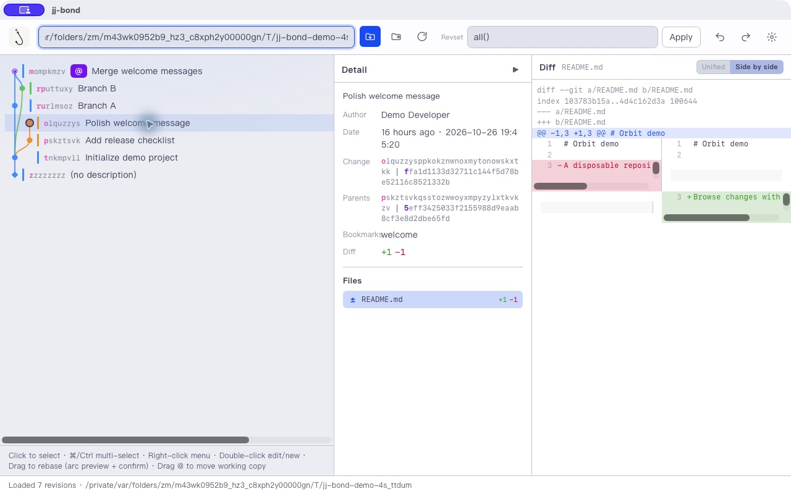

# jj-bond

**English** | [简体中文](README.zh-CN.md)

A desktop GUI for [Jujutsu](https://jj-vcs.dev/) (`jj`), built with React and Tauri.
Explore revision history as a graph, inspect diffs, and perform common revision
operations without leaving the application.

The interface supports Chinese and English, light/dark/system themes, and compact
or detailed graph rows.

The initial open-source version is **0.1.0** (early development). Installers are
published from [GitHub Releases](https://github.com/zhm20001/jj-bond/releases)
without code signing or notarization; see [Download and install](#download-and-install).
See the [changelog](CHANGELOG.md) and [version policy](docs/RELEASING.md#version-policy).

Repository: [zhm20001/jj-bond](https://github.com/zhm20001/jj-bond).
Report bugs and contact the maintainer through [Issues](https://github.com/zhm20001/jj-bond/issues).



## Download and install

jj-bond drives the `jj` executable; install [Jujutsu](https://jj-vcs.dev/)
first (local checks use jj 0.46.0).

### macOS (Apple silicon and Intel)

With [Homebrew](https://brew.sh):

```sh
brew install --cask zhm20001/tap/jj-bond
```

Or download the `.dmg` from the
[latest release](https://github.com/zhm20001/jj-bond/releases/latest) and drag
`jj-bond.app` to `Applications`. The build is unsigned, so the first launch
needs a one-time approval: double-click the app, then open
**System Settings → Privacy & Security**, scroll down and click
**Open Anyway** (or run `xattr -cr /Applications/jj-bond.app` instead).

### Windows and Linux

Download the installer from the
[latest release](https://github.com/zhm20001/jj-bond/releases/latest)
(`.exe`/`.msi` on Windows, `.deb`/`.rpm`/`.AppImage` on Linux). Windows may
show a SmartScreen warning for the unsigned build; choose
**More info → Run anyway**. These installers are CI builds; interactive
Windows/Linux GUI validation is still in progress.

Verify any download against the `checksums-*.txt` files shipped with each
release.

## Features

- Canvas revision graph with bookmarks, change IDs, working-copy and conflict indicators.
- Revision details, file diffs, and unified or side-by-side views.
- Revset filtering and multi-selection.
- Edit/new revisions, descriptions, bookmarks, drag-to-rebase, undo and redo.
- Conflict inspection and ours/theirs resolution.
- Resizable panels and saved preferences.

Repository operations run the installed `jj` executable and can modify your working
copy and history. Use a disposable repository when trying unfamiliar operations.

## Build and run

Install these prerequisites:

- **Node.js 24+** and npm (tests import TypeScript directly).
- Rust stable and the [Tauri 2 platform prerequisites](https://v2.tauri.app/start/prerequisites/).
- `jj` on `PATH`. Local checks use **jj 0.46.0**; older versions are not certified.

From the repository root:

```sh
npm ci
npm run tauri dev
```

On first launch, enter the path of an existing jj repository in the toolbar.
A saved repository is reopened on later launches. To select one explicitly:

```sh
JJ_BOND_REPO=/absolute/path/to/repository npm run tauri dev
```

The desktop executable also accepts `--repo /absolute/path/to/repository`.
The repository must already be initialized with jj.

### Browser development

```sh
npm run dev
```

Open `http://localhost:1420` and enter a repository path, or use a URL-encoded
`repo` query parameter. The Vite development bridge runs real jj commands locally;
it is not a read-only demo. Keep it on loopback and do not expose it to untrusted
networks. The bridge rejects non-loopback peers, unexpected Host/Origin headers,
cross-site browser requests and non-JSON mutations. Browser mode and desktop mode
have separate preferences.

`npm run preview` serves the frontend build only and does not provide the jj bridge.

### Checks and packaging

```sh
npm run check
npm run test:rust -- --locked
npm run tauri build
```

The first command runs TypeScript helper tests, a temporary-repository browser
bridge test, type checking and the frontend production build. Rust integration tests create and clean up temporary jj repositories;
they require jj on PATH but no personal repositories. Tauri writes installers under
`src-tauri/target/release/bundle/`. Consult [the release checklist](docs/RELEASING.md)
before distributing binaries.

## Development

| Path | Responsibility |
| --- | --- |
| `src/App.tsx` | Application state and revision operations |
| `src/components/` | Graph, details, dialogs and toolbar |
| `src/api.ts` | Tauri / development bridge adapter |
| `src/i18n.ts` | Chinese and English strings |
| `src-tauri/src/jj.rs` | jj subprocess integration |
| `src-tauri/src/graph.rs` | Graph layout |
| `src-tauri/src/detail.rs` | Diff and detail parsing |
| `src-tauri/src/prefs.rs` | Desktop preferences |
| `scripts/jj-bridge.mjs` | Browser development backend |

Desktop preferences use the platform configuration directory from Rust `directories`
(`dev`, `jj-bond`, `jj-bond`); browser preferences use `~/.config/jj-bond/prefs.json`.
The browser bridge duplicates some Rust behavior, so backend changes must consider both.

See [CONTRIBUTING.md](CONTRIBUTING.md) for the jj workflow and validation expectations.

## License

Copyright 2026 Phantiverse and jj-bond contributors.
Licensed under [Apache-2.0](LICENSE). See [NOTICE](NOTICE) and
[third-party dependency notes](THIRD_PARTY_NOTICES.md).
