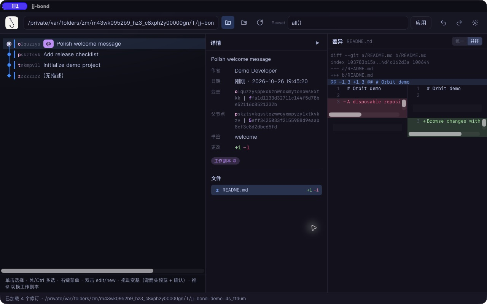

# jj-bond

[English](README.md) | **简体中文**

基于 React 和 Tauri 构建的 [Jujutsu](https://jj-vcs.dev/)（`jj`）桌面图形界面。
通过图谱浏览修订历史、查看差异，并直接完成常用的版本管理操作。

界面支持中英文、浅色／深色／跟随系统主题，以及紧凑或详细的图谱行。
目前提供源码构建方式；安装包发行与各平台验证属于单独的发布工作。

首个开源版本定为 **0.1.0**（早期开发阶段）。参见[变更记录](CHANGELOG.md)和
[版本规则](docs/RELEASING.md#version-policy)。这不表示安装包已经发布或签名。

仓库：[zhm20001/jj-bond](https://github.com/zhm20001/jj-bond)。
问题反馈与维护者联系渠道：[Issues](https://github.com/zhm20001/jj-bond/issues)。



## 功能

- Canvas 修订图谱，显示书签、Change ID、工作副本及冲突状态。
- 修订详情、文件差异，以及统一或并排差异视图。
- Revset 筛选与多选。
- 编辑或新建修订、修改描述、管理书签、拖拽变基、撤销与重做。
- 查看冲突，并使用 ours／theirs 解决冲突。
- 可调整大小的面板与持久化偏好设置。

仓库操作会调用本机安装的 `jj`，可能修改工作副本和历史。
尝试不熟悉的操作时，建议使用临时仓库。

## 构建与运行

先安装以下依赖：

- **Node.js 24+** 和 npm（测试直接导入 TypeScript 源码）。
- Rust stable，以及 [Tauri 2 对应平台的系统依赖](https://v2.tauri.app/start/prerequisites/)。
- `PATH` 中可用的 `jj`。本地验证使用 **jj 0.46.0**，尚未验证旧版本兼容性。

在项目根目录执行：

```sh
npm ci
npm run tauri dev
```

首次启动时，在工具栏输入已有 jj 仓库的路径。后续启动会重新打开上次保存的仓库。
也可以显式指定仓库：

```sh
JJ_BOND_REPO=/absolute/path/to/repository npm run tauri dev
```

桌面可执行文件也接受 `--repo /absolute/path/to/repository` 参数。
目标仓库需要事先使用 jj 初始化。

### 浏览器开发模式

```sh
npm run dev
```

打开 `http://localhost:1420`，输入仓库路径；也可以通过经过 URL 编码的 `repo`
查询参数指定路径。Vite 开发桥接服务会在本机执行真实的 jj 命令，并非只读演示。
请保持服务仅监听本机回环地址，不要暴露到不可信网络。
桥接拒绝非回环地址、异常 Host/Origin、跨站浏览器请求和非 JSON 写操作。
浏览器模式和桌面模式使用各自独立的偏好设置。

`npm run preview` 只提供前端构建产物，不包含 jj 桥接服务。

### 检查与打包

```sh
npm run check
npm run test:rust -- --locked
npm run tauri build
```

第一个命令执行 TypeScript 辅助函数测试、临时仓库浏览器桥接测试、类型检查和前端生产构建。
Rust 集成测试会自行创建并清理临时 jj 仓库，需要 `PATH` 中存在 jj，不依赖个人仓库。
Tauri 将安装包输出到 `src-tauri/target/release/bundle/`。
分发二进制文件前，请检查[发布清单](docs/RELEASING.md)。

## 开发说明

| 路径 | 职责 |
| --- | --- |
| `src/App.tsx` | 应用状态与修订操作 |
| `src/components/` | 图谱、详情、对话框与工具栏 |
| `src/api.ts` | Tauri／开发桥接适配层 |
| `src/i18n.ts` | 中英文界面文案 |
| `src-tauri/src/jj.rs` | jj 子进程调用 |
| `src-tauri/src/graph.rs` | 图谱布局 |
| `src-tauri/src/detail.rs` | 差异与详情解析 |
| `src-tauri/src/prefs.rs` | 桌面偏好设置 |
| `scripts/jj-bridge.mjs` | 浏览器开发后端 |

桌面偏好设置位于 Rust `directories` 根据 `dev`、`jj-bond`、`jj-bond`
确定的平台配置目录；浏览器偏好设置位于 `~/.config/jj-bond/prefs.json`。
浏览器桥接服务复制了部分 Rust 后端行为，因此修改后端时需要兼顾两种运行方式。

jj 工作流程与验证要求见[贡献指南](CONTRIBUTING.md)。

## 许可证

Copyright 2026 Phantiverse and jj-bond contributors.

本项目采用 [Apache-2.0](LICENSE) 许可证。
另请参阅 [NOTICE](NOTICE) 和[第三方依赖说明](THIRD_PARTY_NOTICES.md)。
